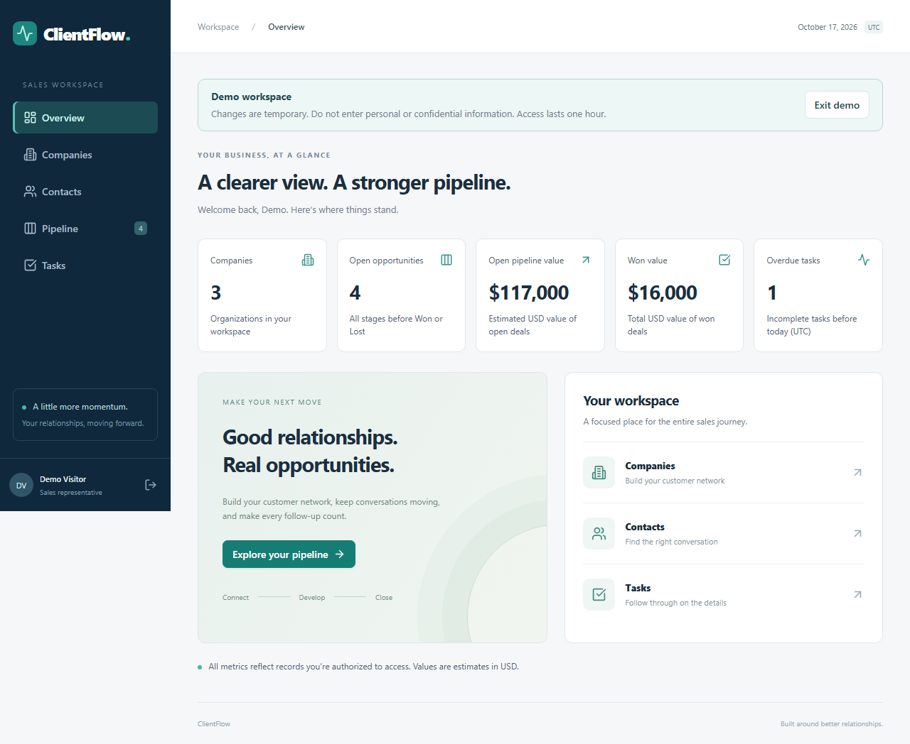
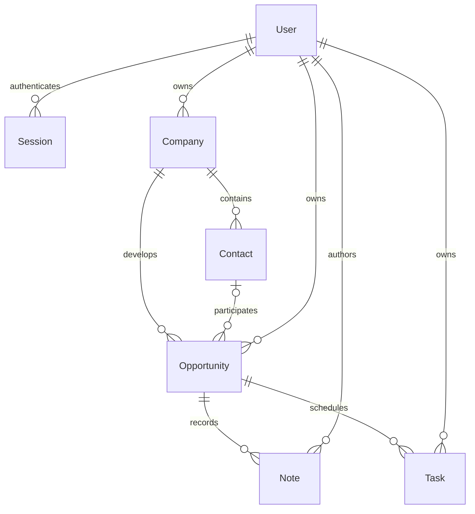

# ClientFlow

A focused CRM for a B2B sales team: connect a company and contact, develop an opportunity, record conversations, schedule follow-ups, and close the deal. An independent interface uses navy navigation, light surfaces, and restrained teal accents.

## First release

- Isolated visitor demos: no credentials, editable sample data, one-hour access, server-side quotas, and safe expiry cleanup.
- Password sign-in, sign-out, persistent database sessions, admin and representative roles.
- Companies and contacts: view, create, edit, search, paginate, and delete when unlinked.
- Opportunity board and details, optional company contact, decimal USD estimates, expected close dates, and six accessible stage controls.
- Timestamped notes with authors, and assigned follow-up tasks with upcoming, overdue, completed, and all filters.
- Authorized database metrics: companies; opportunities excluding Won/Lost; their estimated USD value; total Won value; incomplete tasks due before today in UTC.
- Responsive layout, labeled controls, keyboard focus, native modal dialogs, deletion confirmation, and loading/error/empty/success states.
- System fonts and local assets; the interface makes no external network requests.

## Preview



See the [screenshot index](documentation/screenshots/README.md) for visitor entry, mobile layouts, companies, pipeline, details, and tasks.

## Prerequisites

Use **Node.js 24 LTS, at least 24.11**, npm 11, and MySQL 8 (8.4 LTS recommended; local verification can also use 8.0). `.nvmrc` selects the 24 line. Development is bound to loopback. No hosted deployment is provided.

Dependencies use React 19, Vite 7, Express 5, Prisma 7 with its MariaDB driver adapter (also supports MySQL), TypeScript 5.9, Node's test runner/Supertest, and Playwright. The lockfile fixes the exact resolved versions. Official compatibility references: [Node releases](https://nodejs.org/en/about/previous-releases), [Vite requirements](https://vite.dev/guide/), [Express 5](https://expressjs.com/en/guide/migrating-5/), [Prisma system requirements](https://docs.prisma.io/docs/orm/reference/system-requirements), [Prisma MySQL setup](https://www.prisma.io/docs/v7/prisma-orm/quickstart/mysql).

Vite 7.3 is a [supported backport line](https://vite.dev/releases); this release fixes its build tooling on that maintained line. ESLint uses its [currently supported major 10](https://eslint.org/version-support/). TypeScript builds and the full browser workflow verify the chosen dependency combination.

## Quick start on Windows

From the repository root:

```powershell
npm ci
npm run setup:local
npm run db:generate
npm run db:migrate
npm run db:seed
npm run dev
```

`setup:local` uses the installed MySQL binary at `C:/Program Files/MySQL/MySQL Server 8.0/bin`. Set `MYSQL_BIN` to another MySQL 8 bin directory if needed. It initializes its own ignored `.runtime/mysql-data`, starts a loopback instance on port **3307**, and creates **clientflow** and **clientflow_test**. It refuses an occupied port it does not recognize and never replaces an existing environment file. Existing normal MySQL databases are not touched. MySQL runs independently of the terminal. To restart this instance, run `npm run setup:local` again. To stop only this managed instance, run `node scripts/stop-local.mjs`.

Open **http://127.0.0.1:5173**. API: **http://127.0.0.1:3001/api**. Use `127.0.0.1` consistently, because cookie host and origin checks distinguish it from `localhost`.

### Local login credentials

The helper generates unique development passwords in the **ignored `server/.env`** file. Open that file locally; do not paste it into issues, screenshots, terminal logs, or version control.

| Account | Role | Password environment key |
| --- | --- | --- |
| admin@clientflow.test | Admin | SEED_ADMIN_PASSWORD |
| avery@clientflow.test | Sales representative | SEED_SALES_ONE_PASSWORD |
| jordan@clientflow.test | Sales representative | SEED_SALES_TWO_PASSWORD |

Run `npm run db:seed` after changing these values to update hashes. The seed is disabled in production, validates all passwords before changing data, uses Argon2id, and avoids duplicating the fictional sample companies. All people and organizations are fictional; email uses reserved test/example domains.

## Bring your own MySQL (all platforms)

Create two separate UTF-8 databases, `clientflow` and `clientflow_test`, and database-scoped users. Copy `server/.env.example` to `server/.env`. Supply a URL with percent-encoded credentials, a random session secret (32+ characters), and three development passwords (12+ characters). Add `TEST_DATABASE_URL` for the separate test database. Never reuse a production database or credentials.

Run the same generate, migrate, seed, and dev commands above, omitting `setup:local`. Migrations use `prisma migrate deploy` and are committed under `server/prisma/migrations`; no reset is part of setup or testing. Separate terminals may run `npm run dev -w server` and `npm run dev -w client`.

| Variable | Purpose |
| --- | --- |
| DATABASE_URL | MySQL development connection; required |
| TEST_DATABASE_URL | Separate database ending `_test`; required for tests |
| SESSION_SECRET | HMAC signing secret, 32+ characters; required |
| APP_ORIGIN | Exact frontend origin, default http://127.0.0.1:5173 |
| PORT | API port, default 3001 |
| NODE_ENV | development, test, or production |
| DEMO_ENABLED | Visitor demo switch; false by default; set true only for deliberate local review |
| SEED_ADMIN_PASSWORD / SEED_SALES_ONE_PASSWORD / SEED_SALES_TWO_PASSWORD | Locally supplied development-only seed passwords |
| API_TARGET | Optional Vite proxy target; browser tests set port 3002 |

No secrets are needed in the client. `.env` files and local runtime data are ignored. CI generates fresh credentials for its isolated service, registers them with log masking, and passes them through its runtime environment. They are not development login credentials.

## Checks

```powershell
npm run db:generate
npm run lint
npm run typecheck
npm run build
npm run test:prepare
npm test
npx playwright install chromium
npm run test:e2e
```

`test:prepare` migrates and seeds **only TEST_DATABASE_URL**. A safety guard requires a distinct database name ending `_test`. Integration tests create unique records and remove only their own lifecycle records. Browser tests retain their fictional workflow records in the test database for inspection. The test API runs on port 3002 and frontend on 5174; Playwright refuses to reuse running servers. Never point these commands at normal development or production data. Each run requires free test ports.

Integration checks cover successful/failed login, CSRF, unauthenticated access, logout, role-based lists and direct-ID detail/update/delete attempts, protected relationships, decimal and date validation, the full CRM lifecycle, database readback, and summary totals. Browser tests run the workflow in desktop Chrome and an iPhone-sized Chromium viewport, including page reload persistence. The mobile profile tests responsive layout, not physical Safari behavior.

GitHub Actions runs the same checks with an isolated MySQL 8.4 service. The workflow is prepared locally; no repository has been created or pushed, so remote CI has not run. See [verification report](documentation/verification.md) for actual local results.

## Structure and relationships

```text
client/                 React screens, forms, styling, browser tests
server/src/             Express API, authentication, authorization, Prisma connection
server/prisma/          schema, versioned migrations, development seed
server/test/            integration test using real isolated MySQL
scripts/                local setup and guarded test process launchers
documentation/          decisions, learning guide, verification evidence
```



Admin can manage all normal-team CRM records and assign them to sales representatives. Representatives can only list, view, create, edit, or delete their own companies, contacts inherited from those companies, opportunities, notes on those opportunities, and tasks. Out-of-scope IDs return 404. Every route applies authorization on the server. All assignees must be sales representatives; an admin may work with any representative's records. A company, its opportunities, and their tasks share one representative. Composite foreign keys enforce this and enforce that an opportunity's optional contact belongs to its company. Reassignment of linked records is deliberately restricted. Foreign keys restrict deletion; users explicitly remove linked records rather than silently cascading customer history.

## Decisions and boundaries

- Single-origin browser design: Vite proxies `/api`, no broad CORS. Writes require the exact allowed Origin plus a random session-bound CSRF header, including login/logout. Protected requests without a valid session return 401 before CSRF validation. The client clears stale state and offers sign-in again; sign-in obtains fresh CSRF and rotates the session. Failed mutations are never replayed. Session validity is also checked on window focus and once per minute while signed in; 403 errors do not sign users out.
- CRM writes acquire ownership guard locks before checking permissions and relationships, and commit before returning success. See [concurrency decisions](documentation/concurrency.md) for the locking protocol, throughput tradeoff, and deterministic real-MySQL regression.
- Opaque random session tokens are HMAC signed; only SHA-256 token hashes are stored in MySQL. Cookies are HttpOnly, SameSite=Lax, eight-hour absolute lifetime for team users (one hour for visitor demos); production uses Secure and the `__Host-` prefix. Login rotates the session. Expired sessions are ignored and periodically removed. Argon2id protects passwords; login is rate limited. Central errors avoid exposing query strings, credentials, or stack traces.
- Login rate limiting is per-process. Before multi-instance deployment, use a shared rate-limit store and explicitly configure a trusted reverse proxy. HTTPS and same-origin frontend/API hosting must be configured before public access; no production hosting configuration is provided.
- MySQL Decimal(14,2) stores money. APIs use decimal strings; client number formatting is display only. No financial calculations occur in JavaScript floats.
- Due and closing dates are calendar dates stored as MySQL DATE and serialized with UTC midnight. Today, overdue classification, and displayed note timestamps consistently use UTC. Due today is upcoming; overdue means strictly earlier than today and incomplete. Notes store instants. The interface identifies UTC dates. This avoids browser timezone date shifts, with the tradeoff that a team's local midnight can differ.
- Search and pagination run on the server (10 records/page, stable ordering). Column counts on the pipeline describe cards on the current page; matching-record totals cover all pages, and dashboard metrics cover all authorized records. Mutations that invalidate a page reload the last valid page. Forms load all authorized relationship options for this small first release; use searchable selectors for larger datasets.
- Notes are append-only except explicit deletion. Stage controls permit direct movement and reopening; there are no mandatory stage gates. No invoicing, inventory, payments, email, or external integrations.
- No public registration, user administration, password reset, MFA, audit log, import/export, bulk operations, or optimistic concurrency interface. No drag-and-drop is needed to change stage. The next milestone is to run the full checks on MySQL 8.4 and complete a private deployment readiness review.

Read the [learning guide](documentation/learning-guide.md) to trace a request and prepare for technical interviews.

## Visitor demo (local review)

The login page includes **Try demo** when `DEMO_ENABLED=true`. It creates a private temporary sales identity and sample records, signs the visitor in without credentials, and allows the existing CRM actions. A banner explains that data is temporary and should contain no personal or confidential information. **Exit demo** invalidates access.

Demo mode defaults to **disabled** in `server/.env.example` and when the setting is absent. Enable it deliberately in your ignored local development environment for review. After updating the source, run `npm run db:generate` and `npm run db:migrate`, then restart `npm run dev` and open `http://127.0.0.1:5173`. No employee credentials are used or published.

Access expires after one hour without renewal. Demo creation is limited to five attempts per IP per hour; workspace quotas limit record growth. Run `npm run demo:cleanup` to remove only expired, explicitly marked demo identities and their records in foreign-key order. Active demos and normal team data are excluded. [Visitor-demo decisions and cleanup instructions](documentation/visitor-demo.md) explain isolation, limits, transactions, lifecycle, and tests. No hosted application is provided; source publication does not enable a public application.

## Independent review package

The [review guide](documentation/review-guide.md) maps code and evidence for independent review. It includes a [15-screen screenshot index](documentation/screenshots/README.md), [exact verification results and pipeline pagination semantics](documentation/verification.md), and reproducible tools for fictional review fixtures, captures, and a source-only ZIP. Existing ZIPs and their 15 screenshots are historical snapshots from before the visitor-demo feature; current visitor-demo evidence is listed separately in the verification document. Actual credentials and runtime data are excluded; reviewers supply their own local environment.
